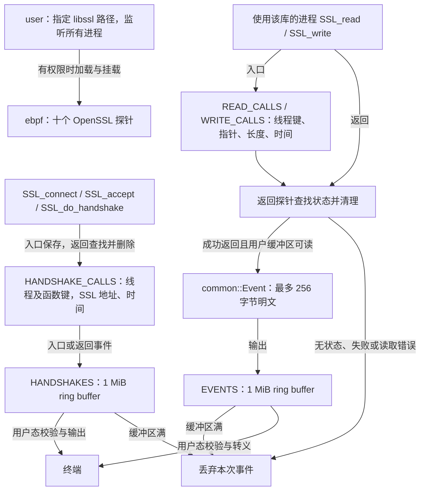

# 架构与事件流

`common` 是 no_std 共享库，定义无隐式填充的 296 字节 `Event`。
另定义 48 字节 `HandshakeEvent`，保留握手入口/返回阶段、函数编号、SSL 地址和有符号返回值。
`ebpf` 编译为 BPF ELF；`user` 在主机运行，通过 Aya 加载并持有探针链接，
读取 ring buffer 后校验事件长度和捕获边界，再转义输出。

探针在内核执行，只通过受保护 helper 读取目标进程地址。
握手探针仅保存 SSL 地址，不解引用 OpenSSL 内部结构。握手与明文事件独立消费，
应使用时间戳分析先后；握手返回 1 表示完成，其他值可能为重试或错误。
状态插入失败将使返回探针找不到对应记录；正常返回和失败返回均先移除已有状态。
退出观察器后内核释放未固定的程序、map 和链接。当前实现不持久化事件。
